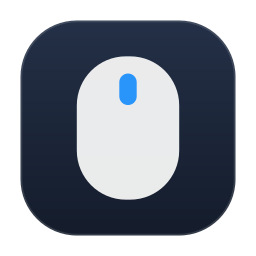

<p align="center">
  
</p>

<h1 align="center">LiteMouse</h1>

<p align="center">
  <strong>Ultra-lightweight native macOS mouse utility for discrete scroll wheels and side buttons.</strong><br>
  Pure AppKit · Zero SwiftUI · Zero IOHIDManager · Zero Idle Wakeups · Universal (Apple Silicon &amp; Intel)
</p>

<p align="center">
  <a href="https://github.com/MUMU-DADA/LiteMouse/actions/workflows/ci.yml"></a>
  <a href="https://github.com/MUMU-DADA/LiteMouse/releases/latest"></a>
  <a href="LICENSE"></a>
  
</p>

<p align="center">
  <strong>English</strong> · <a href="README.zh-CN.md">简体中文</a>
</p>

---

## Overview

**LiteMouse** fixes the two biggest annoyances of using a regular mouse on macOS — non-linear wheel acceleration and non-working back/forward side buttons — without dragging in heavy background daemons, SwiftUI overlays, battery pollers, or broad input hooks.

### Design Principles

- **Minimal event tap mask (`kCGSessionEventTap`)** — Intercepts *only* `scrollWheel`, `otherMouseDown`, and `otherMouseUp`. Pointer movement (`mouseMoved`), left/right clicks, dragging, and typing never invoke LiteMouse's callback (**0 µs added latency**).
- **KVM / Deskflow friendly** — Because the tap lives at `kCGSessionEventTap` (above `kCGHIDEventTap`), software KVMs such as Deskflow pass scroll wheels and side buttons cleanly to remote machines without interference.
- **Complete hook teardown when paused** — Disabling LiteMouse (or turning off both scroll and side buttons) destroys the `CFMachPort` and stops the dedicated RunLoop thread completely.
- **Discrete physical wheels only** — Checks `scrollWheelEventIsContinuous == 0` so Trackpads and Magic Mouse stay completely untouched, even with reverse scroll enabled.
- **Unaccelerated linear or display-synced smooth scrolling** — Choose between crisp fixed-line linear steps (stripping macOS's pre-tap acceleration curve) or a sub-pixel-accurate exponential-decay smooth scroll animator that auto-matches your display refresh rate (60Hz / 120Hz / 240Hz) and stops its timer immediately when idle.
- **Smart side-button Back / Forward routing** — Automatically chooses the best mechanism per target app:
  - **Native `navigationSwipe` gesture**: Apple apps (`com.apple.*`), Firefox, ForkLift, Opera
  - **`⌘[` / `⌘]` shortcut**: Obsidian, Notion, Slack, Spotify
  - **Passthrough**: VS Code, Chrome, and apps with built-in Mouse 4/5 handling
- **Zero third-party dependencies** — Pure Swift + AppKit + CoreGraphics (~600 KB universal binary), builds with Xcode Command Line Tools alone.

---

## Installation

1. Download `LiteMouse-<version>-macos-universal.dmg` from [Releases](https://github.com/MUMU-DADA/LiteMouse/releases).
2. Open the disk image and drag **LiteMouse.app** into **Applications**.
3. Launch **LiteMouse** from Applications:
   - Because releases are ad-hoc signed, macOS Gatekeeper may ask for confirmation on first run — open **System Settings › Privacy & Security** and click **Open Anyway**.
   - Click the LiteMouse menu bar icon and grant **Accessibility** permission (**System Settings › Privacy & Security › Accessibility**). LiteMouse detects the grant automatically and activates immediately.

---

## Configuration

LiteMouse stores its settings in `~/.config/litemouse/config.json` and **hot-reloads** automatically when edited on disk (you can also adjust common options from the menu bar icon).

```json
{
  "backForward": {
    "backButtonNumber": 3,
    "cmdBracketBundleIds": [
      "md.obsidian",
      "notion.id",
      "com.tinyspeck.slackmacgap",
      "com.spotify.client"
    ],
    "fallback": "passthrough",
    "forwardButtonNumber": 4,
    "mode": "auto",
    "swipeBundleIds": [
      "com.apple.*",
      "org.mozilla.firefox*",
      "com.binarynights.ForkLift*",
      "com.operasoftware.Opera"
    ]
  },
  "enabled": true,
  "scroll": {
    "horizontalLines": 3,
    "mode": "linear",
    "reverseHorizontal": false,
    "reverseVertical": false,
    "smoothDurationMs": 130,
    "smoothPixelsPerLine": 18,
    "verticalLines": 4
  }
}
```

| Field | Values | Description |
|---|---|---|
| `enabled` | `true` / `false` | Master switch; `false` tears down the `CGEventTap` completely |
| `scroll.mode` | `"linear"`, `"smooth"`, `"disabled"` | Fixed unaccelerated steps, display-synced smooth scrolling, or off |
| `scroll.verticalLines` / `horizontalLines` | `1`–`30` | Lines per wheel detent (default `4` / `3`) |
| `scroll.reverseVertical` / `reverseHorizontal` | `true` / `false` | Invert mouse wheel direction without affecting Trackpad |
| `scroll.smoothPixelsPerLine` | `4`–`120` | Pixel travel per line in smooth mode (default `18`) |
| `scroll.smoothDurationMs` | `30`–`500` | Smooth decay duration in milliseconds (default `130`) |
| `backForward.mode` | `"auto"`, `"swipe"`, `"cmdBracket"`, `"disabled"` | Side-button routing strategy |
| `backForward.fallback` | `"passthrough"`, `"cmdBracket"`, `"swipe"` | Behavior for apps not listed in `swipeBundleIds` / `cmdBracketBundleIds` |
| `backForward.backButtonNumber` / `forwardButtonNumber` | Integer | CoreGraphics mouse button numbers (default `3` / `4`) |

---

## Building from Source

### Requirements
- macOS 14.0+
- Swift 6.0+ (Xcode or Xcode Command Line Tools)

### Run Unit Tests

```bash
./scripts/test.sh
```

### Build `.app` Bundle

```bash
# Native architecture (fast local build)
./scripts/build-app.sh release

# Universal binary (arm64 + x86_64)
UNIVERSAL=1 ./scripts/build-app.sh release
```

### Package & Verify `.dmg`

```bash
./scripts/package-dmg.sh
```

### Install to `/Applications`

```bash
./scripts/install.sh
```

---

## Architecture

```text
LiteMouse/
├── Package.swift                             # SwiftPM manifest (zero external dependencies)
├── Sources/
│   ├── LiteMouseCore/                        # Pure, testable core logic
│   │   ├── Config.swift                      # Codable config schema & ~/.config/litemouse store
│   │   ├── ScrollPhysics.swift               # Linear step & exponential-decay smooth scroll integrator
│   │   └── BackForwardRouter.swift           # Per-bundle-ID side-button routing
│   └── LiteMouse/                            # AppKit menu bar application
│       ├── main.swift                        # Accessory NSApplication entry point
│       ├── AppDelegate.swift                 # Status item menu, kqueue config hot-reload, AX check
│       ├── EventTapController.swift          # Dedicated-thread CGEventTap with narrow 3-event mask
│       ├── SmoothScrollAnimator.swift        # On-demand display-refresh-synced DispatchSourceTimer
│       ├── EventSynthesizer.swift            # Navigation swipe, ⌘[/⌘], and continuous scroll synthesis
│       └── LaunchAgentManager.swift          # ~/Library/LaunchAgents/local.litemouse.app.plist manager
├── Tests/LiteMouseCoreTests/                 # Swift Testing unit tests
├── scripts/                                  # Test, app bundle, icon generator, DMG packager & installer
└── assets/icon.svg                           # Vector app icon
```

---

## License

Licensed under the [MIT License](LICENSE).
